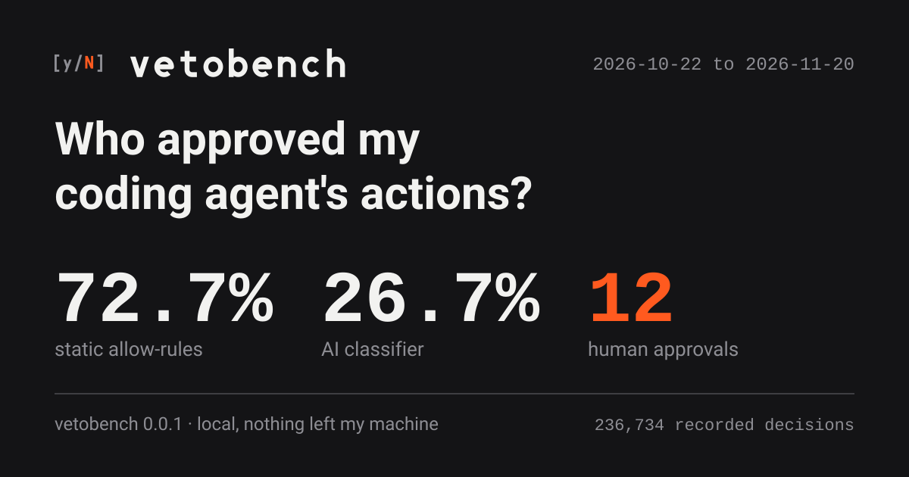

<h1>
  <picture>
    <source media="(prefers-color-scheme: dark)" srcset="assets/logo/lockup-dark.svg">
    
  </picture>
</h1>

**Who approved your coding agent's actions?**

[](https://github.com/vetobench/vetobench/actions/workflows/ci.yml) [](https://scorecard.dev/viewer/?uri=github.com/vetobench/vetobench) [](LICENSE) [](#is-it-safe-to-run) [](#is-it-safe-to-run)

### In 30 days I approved 12 of my coding agent's 236,734 actions myself.

Static allow-rules and an AI classifier approved almost all the rest. vetobench shows you the same split for your own agent, from the transcripts already on your machine.



<sub>My own card for those 30 days, drawn by vetobench's <code>--svg</code> option.</sub>

## Run it on your own agent

```sh
npx vetobench
```

You need Node 18 or later. It reads the Claude Code transcripts in `~/.claude/projects` and prints the card in your terminal. Nothing is sent anywhere.


## What it finds

- **Who approved each action:** a static allow-rule, the AI classifier (auto mode), or you through a permission prompt. In my 30 days, static allow-rules approved 72.7%, the classifier 26.7%, and I approved 12 actions.
- **Where the agent was running:** interactive main sessions, loops (`/loop`, `/goal`) and subagents. 69.2% of my agent's actions ran inside subagents and 2.5% in loops, and I approved none of them. All 12 of my approvals came from interactive main sessions.
- **Wildcard rules doing the work:** how many shell actions went through only because of a broad rule like `git:*` or `python3:*`. For me, more than 29,000 in 30 days (an estimate, and a lower bound).
- **Allow-rules that never fired:** the shell allow-rules in your global and project settings that never approved a command in the window. Before my cleanup, about 85% of mine had not approved a single command in 30 days (an estimate).
- **Secrets left in plain text:** with `--secrets`, counts of passwords, keys and tokens sitting in your transcripts, by category. No value is ever printed or written.
- **What a guard policy would have asked:** `replay` runs an "ask before production writes, CI triggers and pushes to main" policy over the shell commands your agent ran, and shows how often it would have asked and how many times a day. My own version of that policy would have asked 15 times in 30 days, over 173,959 shell commands.

Every number above comes from my own transcripts for 2026-10-22 to 2026-11-20 and has a line in [CLAIMS.md](CLAIMS.md) with the exact command behind it. [METHODOLOGY.md](METHODOLOGY.md) defines each term.

## Clean up your rules

```sh
npx vetobench fix           # a dry run: counts what it would remove
npx vetobench fix --write   # removes them, after backing each file up
```

`fix` removes allow-rules that hold a secret, broad wildcards on an interpreter or remote command (`python3:*`, `ssh:*`, `git:*` and similar), and shell rules that never approved a command in your transcript history. It changes only `permissions.allow` in your own settings: `~/.claude/settings.json` and each project's `settings.local.json`. A project's shared `.claude/settings.json` stays as it is unless you pass `--include-shared`. Every file is copied into `~/.claude/vetobench-backups/` first, readable only by you, only the `allow` array is edited (the rest of the file stays byte for byte), and the output is counts only. A rule is only called never-used with at least 14 days of history in its project, and rules with a mid-rule wildcard, `&&`, `|`, a heredoc or a leading `VAR=value` never are. A removed rule you still need comes back the next time you approve it. Keep wildcards or never-used rules with `--keep-wildcards` and `--keep-unused`.

## More commands

| Command | What it does |
|---|---|
| `npx vetobench doctor` | A checkup of your permission settings: eleven fixed checks (allow-rules with a secret, broad wildcards, a bare `Bash` allow, prompts turned off, MCP servers allowed wholesale, no deny rules and more), each with a level and a count. `--ci` exits 1 on a high finding. [Docs](https://github.com/vetobench/vetobench/blob/main/docs/doctor.md) |
| `npx vetobench drift` | Who approved your agent's actions, week by week, with each share's change against the week before. [Docs](https://github.com/vetobench/vetobench/blob/main/docs/drift.md) |
| `npx vetobench graph --html report.html` | One self-contained HTML page with the card over time: a chart by who approved, a chart by where the agent ran, and the totals. Each bar is a UTC day, or a bucket of whole weeks when the window is longer than 92 days. No scripts from anywhere, no network. [Docs](https://github.com/vetobench/vetobench/blob/main/docs/graph.md) |
| `npx vetobench mcp` | Your MCP permission surface: servers by scope and transport, the allow-rules that let their tools run without asking, and who approved the MCP calls in your transcripts. Never a server or tool name. [Docs](https://github.com/vetobench/vetobench/blob/main/docs/mcp.md) |
| `vetobench hook install` | Puts the `replay` policy in front of your agent as a Claude Code hook: it asks you before production writes, CI triggers and pushes to main. A dry run unless `--write`; needs `npm install -g vetobench`. [Docs](https://github.com/vetobench/vetobench/blob/main/docs/hook.md) |
| `npx vetobench scrub` | Finds passwords, keys and tokens left in plain text in your transcripts and replaces only the value with `[redacted:<category>]`. A dry run unless `--write`; backups first; open sessions are left alone. Rotate the secrets anyway. [Docs](https://github.com/vetobench/vetobench/blob/main/docs/scrub.md) |
| `npx vetobench check-settings` | For CI: fails when committed settings allow-rules hold a secret, a broad wildcard or a bare `Bash` allow. Also as a GitHub Action in [`action/`](action/README.md). |

A note on Codex CLI: its transcripts record each tool call but not who approved it, so a Codex card would have to guess. [The research note](https://github.com/vetobench/vetobench/blob/main/docs/codex.md) has the details.

## What you'll see

<details>
<summary>My card in the terminal, same 30 days</summary>

```
vetobench 0.1.0: who approved your agent's actions
1,744 transcripts · 2026-10-22 to 2026-11-20 · 236,734 of 237,087 tool calls carry a recorded decision

  Static allow-rules (compound command)                 116,860    49.4%
  AI classifier                                          63,308    26.7%
  Static allow-rule (single command)                     52,412    22.1%
  ...
  You, through a permission prompt                           12   0.005%

Static rules approved 72.7%, the AI classifier 26.7%, you 12 action(s).

Where the agent was running:
  Main sessions (interactive)     67,118    28.4%   rules 70.6% · classifier 28.1% · you 12
  Loops (/loop, /goal)             5,880     2.5%   rules 73.4% · classifier 26.1% · you 0
  Inside subagents               163,736    69.2%   rules 73.5% · classifier 26.2% · you 0
```

</details>

## Is it safe to run?

vetobench reads files on your machine and prints counts. The exceptions: `--svg` and `graph --html` write the one file you name, and replace an existing file only with `--force`. `fix --write` and `hook install --write` (or `uninstall --write`) edit your own settings files, and `scrub --write` edits your transcripts; these copy each existing file into a backup folder before they change it. You can check each part:

- **No network code ships.** [`test/no-egress.test.js`](test/no-egress.test.js) fails if anything in `bin/` or `src/` imports a module that can reach the network, start another program or load other code (`http`, `https`, `net`, `tls`, `dgram`, `dns`, `child_process`, `module`, `vm` and a few more, submodules such as `dns/promises` included), uses `createRequire`, loads a module by a computed name, runs code from a string, touches `globalThis`, or mentions `fetch`, `WebSocket`, `XMLHttpRequest` or `EventSource` at all. The test also checks itself against known ways around it.
- **CI runs every command with no network.** On Node 18, 20 and 22, CI runs these against the synthetic fixtures inside a Linux network namespace with no network: the card (text, `--json`, `--md`, `--share`, `--svg`, `--secrets`), `replay --json`, `drift` (text, `--md`, `--asks --json`), `graph --html`, `doctor --json`, `mcp --json`, `hook run`, `hook install` (refused from a copy that is not a global install; a dry run, `--write` and `uninstall --write` from one that is), `fix` (a dry run and `--write`, in a throwaway home), `scrub` (a dry run, and `--write` on a throwaway copy of the fixtures) and `check-settings`. See [`ci.yml`](.github/workflows/ci.yml).
- **Zero runtime dependencies, no install scripts.** Nothing else is installed with it and nothing runs at install time. The same test checks `package.json` for both.
- **Counts only.** The output never contains commands, file paths, prompts, rule bodies or secret values, so a card is safe to paste in public.
- **Short enough to read.** The whole source is in [`bin/`](bin) and [`src/`](src).

## The benchmark

The card is the first half. The second is an open benchmark of agent permission guards, Claude Code's own classifier among them, measured on real agent traffic labelled by hand. Results come out in January 2027, after each guard's authors have had 14 days to review their numbers and reply.

## Follow along

vetobench is built in public. Progress, new numbers and the benchmark go out on X at [@vetobenchai](https://x.com/vetobenchai).

## Principles

- **Every number is reproducible.** Each one has a line in [CLAIMS.md](CLAIMS.md): the claim, whether it is measured or estimated, the window, and the command. Definitions and caveats are in [METHODOLOGY.md](METHODOLOGY.md).
- **Corrections are public.** A wrong number is retracted in the [changelog](CHANGELOG.md) and stays in CLAIMS.md, marked as retracted.
- **Open source, no paid product.** Apache-2.0.

## Options

```
npx vetobench [transcripts-dir] [options]

  --since / --until YYYY-MM-DD   window by UTC day (until is exclusive)
  --rules FILE                   match approvals against this settings file's allow-rules instead of your
                                 current ones (repeatable: use the settings that were in effect for the window)
  --secrets                      also count passwords, keys and tokens left in your transcripts (slower)
  --json                         aggregates as JSON (counts only)
  --md / --share / --svg FILE    share formats, see below

npx vetobench replay [transcripts-dir] [--since] [--until] [--policy FILE] [--json]
npx vetobench fix [transcripts-dir] [--write] [--include-shared] [--keep-wildcards] [--keep-unused] [--since] [--until] [--json]
npx vetobench doctor [transcripts-dir] [--json] [--ci]
npx vetobench drift [transcripts-dir] [--weeks N] [--since] [--until] [--asks] [--json | --md]
npx vetobench graph --html FILE [transcripts-dir] [--since] [--until] [--force]
npx vetobench mcp [transcripts-dir] [--since] [--until] [--json]
vetobench hook install|uninstall [--write] [--project] [--policy FILE]
npx vetobench check-settings [file]... [--json]
npx vetobench scrub [transcripts-dir] [--write] [--since] [--until] [--json]
```

The default directory is `~/.claude/projects`. Each tool call is counted once, even when a resumed session copied it into another transcript. The card also audits your allow-rules: it reads your global settings and those of every project your sessions ran in, and counts the shell rules that never approved a command in the window. Claude Code records a permission decision for each tool call from about v2.1.306 onward.

## Share your card

```
npx vetobench --md               # the card as markdown
npx vetobench --svg card.svg     # also write a 1200×630 image for posts (--force replaces the file)
npx vetobench --share            # the markdown, then a link to a prefilled "Submit your card" issue
```

Every format holds counts, shares, dates and version strings only. vetobench never opens the link and sends nothing: read the card, then open the link yourself. Most social sites want PNG, so open the SVG in a browser and screenshot it, or convert it with any SVG tool.

## Replay a guard policy

```
npx vetobench replay [transcripts-dir] [--since YYYY-MM-DD] [--until YYYY-MM-DD] [--policy file] [--labels file] [--json]
```

Replays an "ask before production writes, CI triggers and pushes to main" policy against the shell commands your agent actually ran. It prints how often the policy would have asked, per category: pushes to main, CI triggers, remote writes over ssh, SQL writes to non-local databases, Kubernetes, Terraform, cloud changes and more. Put your own hosts, protected branches and extra rules in a JSON file and pass it with `--policy`. It also shows the asks per day, because a prompt you see rarely still gets read. Pass your own verdicts with `--labels` to count right and wrong asks. The format is in [METHODOLOGY.md](METHODOLOGY.md#replay-vetobench-replay). Like the card, it prints counts only, never a command.

## License

Apache-2.0
